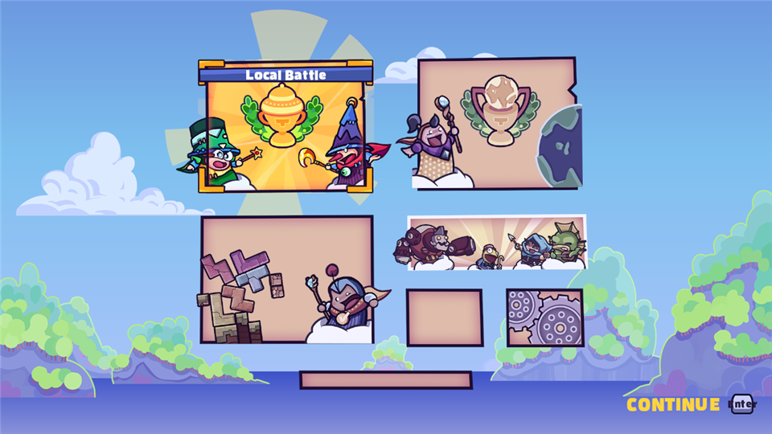
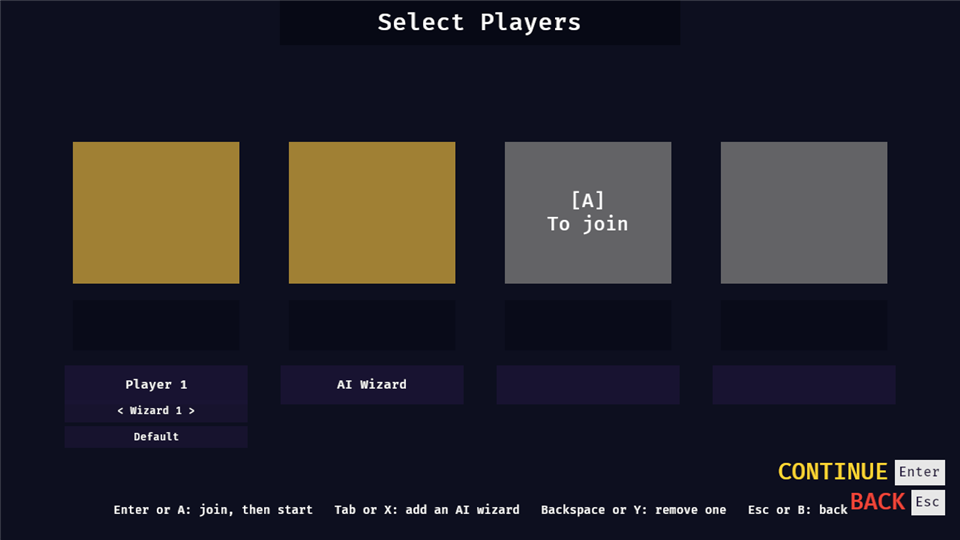
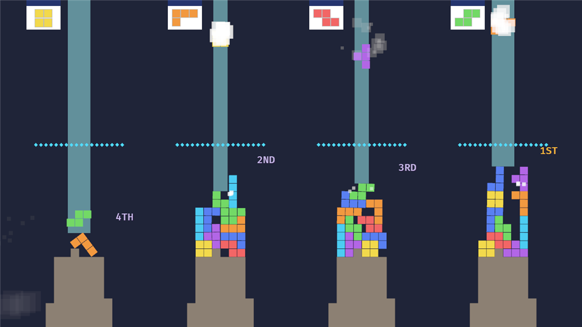
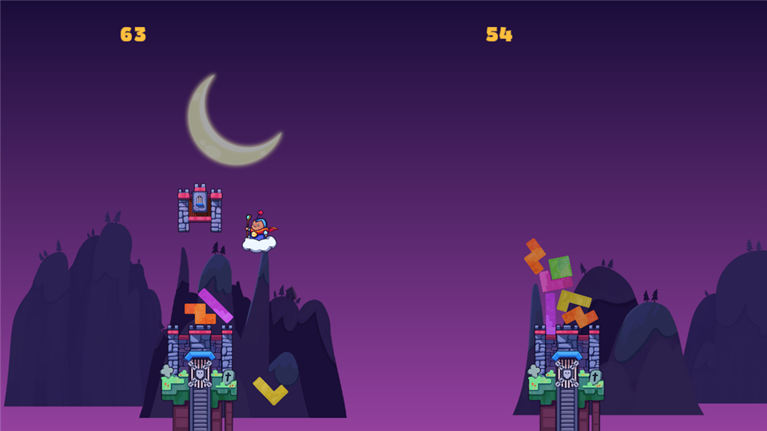
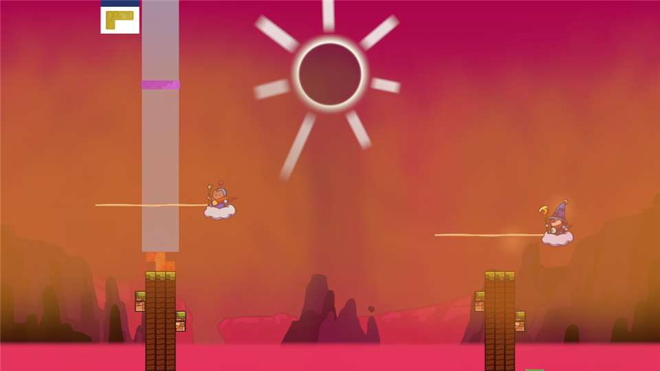

# Tricky Towers, rebuilt in Rust + Bevy

[](https://github.com/Yaekai/tricky-towers-rs/actions/workflows/test.yml)

An unofficial, from-scratch rebuild of WeirdBeard Games' physics brick-stacking game
*Tricky Towers*, aiming to match the original 1:1 (rules, values, menus, look and sound) and to
be easy to mod.

> **This repository contains no game content.** No code, art, sound, fonts or level data from
> the original are in it. The game's art and sound are read at runtime from **your own copy**
> of Tricky Towers, which you must own; without it, everything is drawn as plain shapes (as in
> the pictures below). Don't share or commit anything you extract from the game.
>
> This is a fan project, not affiliated with or endorsed by WeirdBeard Games. *Tricky Towers*
> and its content belong to their owners; to play the real game, buy it. The licence below
> covers only the code in this repository. If you hold rights to the game and want something
> changed or removed, please open an issue.

| | |
|---|---|
|  |  |
|  |  |



*All pictures use the built-in placeholder shapes, not the original's art.*

The offline game is playable, including local battles and cups, all 50 trials, and the
three Endless modes. Work is now focused on comparing the remaining physics, camera,
spell and menu details with the original. The [progress report](#current-progress)
below covers the current build and the remaining work.

## What you need
| | |
|---|---|
| Rust | stable toolchain (`rustup`) |
| Linux only | `libasound2-dev libudev-dev libxkbcommon-dev libwayland-dev` |
| Optional: the original's look and sound | a PC install of *Tricky Towers* you own, [AssetRipper](https://github.com/AssetRipper/AssetRipper) and Windows PowerShell |

The first build compiles Bevy and takes several minutes.

## 1. Build and run
```
cargo run                                        # play, with placeholder shapes
cargo run -- --play survival --difficulty pro    # skip the menus
cargo run -- path/to/mod.ron                     # load another config
cargo test                                       # config and headless gameplay tests
```

**Keys** (the original's defaults): arrows move, Up / Space turn, Down drops faster, U / I
nudge, J light spell, K dark spell, Esc pause. Players 2 to 4 use gamepads. Keys can be
rebound in Settings → Keybinding.

## 2. Optional: use the art and sound from your own install
The scripts in [`tools/extract/`](tools/extract/README.md) read your install (exported with
AssetRipper) and fill the `extracted/` folder, which the game loads at startup. They only read
from the game. `extracted/` and `research/` are ignored by git, and the `.gitignore` is a
whitelist, so extracted files can't be committed by accident. How the folder is laid out:
[`docs/art-layout.md`](docs/art-layout.md).

## Layout
```
src/gameplay.rs, spells.rs, ai.rs   core rules, headless (no rendering or keyboard)
src/trials.rs, cups.rs, collapse.rs trials, cups, match end (headless)
src/input.rs                        writes each tower's PlayerInput (keyboard, pads, bots)
src/art.rs, letters.rs, mods.rs     loading art, sound, letters and mods at runtime
src/visuals.rs, hud.rs, packs.rs …  the in-match look, effects and shaders
src/menu.rs, select.rs, settings.rs … the menu screens
assets/config/game.ron              every tunable value (GameConfig, src/config.rs)
tools/extract/                      PowerShell scripts that stage your own install's art
docs/research/                      plain-language notes on how the original behaves
tests/                              headless gameplay and menu tests
```
Every tower, human or bot, runs through the same systems; only the writer of its `PlayerInput`
differs, which keeps bots, replays and netplay simple. More in [`PLAN.md`](PLAN.md).

## Current progress

Updated 12 November 2026.

The playable offline features are implemented. Comparisons with the original continue
through headless regressions, local measurements and silent offscreen captures. The
remaining work is tracked in [WHATS_NEXT](docs/WHATS_NEXT.md), with observations in the
[behavior audit](docs/research/parity-audit-2026-11-03.md) and [research notes](docs/research/).

| Area | Implemented | Remaining work |
|---|---|---|
| Local battles | Race, Survival and Puzzle at Easy, Normal and Special, with up to four towers | Further match comparisons and hardware controller checks |
| Local cups | Tiny, Big and Super cups, standings, overtime, random match choices and the winner popup | Remaining animation, voice and effect timing comparisons |
| Endless | Race pacer and checkpoints, Survival curse waves, Puzzle levels and obstacles, saved leaderboards | Further long-run comparisons |
| Trials | All 50 trials across five tiers, fixed brick orders, enemy curses, rival towers, floors, medals and tier unlocks | Reproduce the exact earlier Trial 9 input sequence and compare remaining trials |
| Controls and physics | Fixed-step shared gameplay for every tower, rotation, nudges, accelerated drop, bases, Ivy clusters and per-part bounds | Further stacking and collision comparisons |
| Spells | All 17 spell kinds, compound curses, award rules and per-difficulty behavior | Remaining measured timings and estimated values |
| Battle cameras and HUD | Centered viewports for Race, Survival and Puzzle, aspect-ratio fitting, lane clipping, HUD placement and independent camera shakes. Wider camera passes put wizards in front of the towers and spell clouds behind them | Remaining background comparisons, Windows scaling and resize checks on hardware |
| Wizards | All 14 characters, animated parts, reactions, per-character voices and controller hints. The cup bolt follows each skin's staged wand path | Remaining pose and animation blend comparisons |
| Brick packs | All eight packs, their effects, masks and material variants | Further visual comparisons |
| Backgrounds and effects | Mode-specific layers, weather, water, wind, flashes, curse skies, splashes and spell effects | Remaining sizes, colors and timings marked `(?)` |
| Match results | Finish countdowns, roofs, collapse, winner and loser effects, trial results and cup celebrations | Remaining effect and timing comparisons |
| Front end | Start and title screens, player and mode selection, single player, Endless and trial menus, pause, explanations, Help and Credits | Remaining layout details and controller glyph checks |
| Settings and saves | Audio and display options, key rebinding, stats, trial progress and Endless scores | Hardware checks for audio mixing, rumble and display changes |
| Languages | The original's 19 languages loaded from the player's install, with translated Pause and results bars and rendered mouse hit targets | Remaining overflow, glyph and hardware scaling checks |
| Online Battle | Initial menu screens | Connected lobby, invites, matchmaking and network play are a separate workstream |
| Shop | Outside the current plan | |

Recent work has closed several specific gaps.

- Multiplayer Puzzle now keeps every tower centered in its own lane as the camera zooms.
  Captures cover two to four seats at 16:9, 21:9 and 5:4, including HUD, lasers and results.
  Race and Survival use the same fitted viewport and HUD path. Wider cameras draw the
  wizards in front of the towers and spell clouds and collected spells behind them.
  Puzzle's shared background laser spans the spaces between the viewports.
- Tilted brick bounds and Puzzle zaps now measure the individual collider parts. A Trial 9
  regression reproduces the old false 2.47-cell top and measures 2.20 after the fix. A known
  six-brick solution clears with zero extra slack. The shipped 0.3-cell allowance stays until
  the earlier reported input sequence is reproduced against the original.
- Slow now follows the measured catch, shake, inflation, stretch and release sequence.
  Large resizes its balloon and grows the brick's collision shape with its picture.
  Enlarged bricks also gain mass in proportion to their scale.
  Bubble's trigger includes its grassy shell, Extra Life follows its pickup path, and
  No Rotate uses the fixed refusal shake and delayed chain sounds.
- Pause freezes gameplay, animation and shader time through its fade. Screen changes commit
  under the black transition. The final trial leads into Credits and back to the Start screen.
- Pause and Game Completed selection bars fit translated text, and mouse input follows
  the displayed bounds. Front-end captures include Russian, Arabic and Japanese at 21:9.
- The cup winner takes input from the winning seat. Light casts finish before queued reactions,
  and the bolt follows the skin's animated wand. The entrance plays the character's cheer,
  and the exit emits the wizard destruction burst.
  Its close fades music and the picture together, including the exit particles.

The next priorities are remaining camera comparisons, the earlier Trial 9 reproduction,
spell and cup presentation comparisons, and a display, audio and controller pass on hardware.
The release pass also needs to resolve the remaining `(?)` values and review development tools.

AI opponents in local battles, config and art mods, and the F1/F3 and scripted development
tools are project additions. Their release decisions are tracked in the
[release checklist](docs/release-checklist.md).

## More docs
- [`PLAN.md`](PLAN.md): goal, approach, architecture and milestones.
- [`docs/modding.md`](docs/modding.md): the `mods/` folder (config changes and art packs).
- [`docs/debug-tools.md`](docs/debug-tools.md): offscreen pictures and scripted runs.
- [`docs/research/`](docs/research/): what was learned about the original, in plain language.
- [`AGENTS.md`](AGENTS.md): rules for AI agents working on the repo, and the development log.

## Contributing
Pull requests for engine code are welcome. Never commit game files, extracted assets or
decompiled code; notes about how the original behaves go in `docs/research/` in your own
words. Tunable numbers go in `GameConfig`, and `cargo test` must pass.

## Credits and licence
*Tricky Towers* is by WeirdBeard Games. Built with [Bevy](https://bevyengine.org) and
[avian](https://github.com/Jondolf/avian); art is staged from your own install with
[AssetRipper](https://github.com/AssetRipper/AssetRipper). The approach follows the
[Rust rewrites and ports](https://github.com/auroraborealisno02/ai-game-modding-guides/blob/main/guides/03-rust-rewrites-and-ports.md)
guide from the AI Game Modding Guides.

The code in this repository is licensed under either of [MIT](LICENSE-MIT) or
[Apache-2.0](LICENSE-APACHE), at your option. The licence does
not cover *Tricky Towers* or anything extracted from it.
