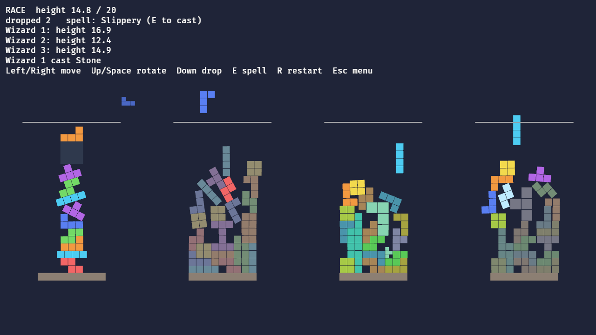

# Tricky Towers, rebuilt in Rust + Bevy

A clean-room reimplementation of the physics brick-stacking game *Tricky Towers*,
written so it is easy to mod. It contains no code or assets from the original game.

## Run
```
cargo run                          # play with assets/config/game.ron
cargo run -- my_mod.ron            # play with another config
cargo run -- --play survival --difficulty pro   # skip the menu
cargo run -- --play race --offscreen shots --shots 5,20   # no window or sound; saves pictures
cargo test                         # config + headless gameplay tests
```
Controls (the original's defaults, from the fan wiki): Left/Right to move, U/I to nudge, Up to
rotate clockwise and Space anticlockwise, Down to drop faster, J to cast your light spell and K
your dark one, R to
restart, Esc to pause (Resume, Retry, Quit), F3 for a debug readout (height, spells, result).

Menus follow the original: "Press Enter to start" under the logo, then the title tiles, where the arrows and Enter pick. Local Battle opens
"Select Players": Enter (or A on a pad) takes a seat, Tab (X) adds an AI wizard, Backspace (Y)
removes one, and Enter again goes on to "Select Mode": two columns, the mode (Race, Survival,
Puzzle or Random) then the difficulty (Easy, Normal, Special or Random), Up/Down to change and
Enter to move on. Single Player shows your seat over Trials and Endless; Endless offers Race,
Survival and Puzzle beside the best scores (kept between runs). Esc (B) steps back. Once the
losing towers have fallen apart after a match, "Game Completed" slides up in the bottom-right
corner with Rematch, Select Mode and Main menu. The Settings tile sets the volume, music volume and full screen (kept
between runs). On Select Mode, C (or the pad's Select) picks a
cup: a series of matches with points per place, a trophy and XP at the end (rules guessed until
read from the original). `--menu title|players|modes|single|endless|pause`
opens on a menu screen, for scripted pictures.

Players 2 to 4 use gamepads: stick or d-pad to move, down to drop, LT/RT to nudge, A/B to rotate,
X for the light spell and Y for the dark one. With one player, a gamepad works for player 1 too.



## What works
Values below come from reading Max's own copy of the original; the notes are in `docs/research/`.
- Controls like the original: half-cell moves (first repeat after 0.2 s, then every 0.05 s), a
  separate one-cell nudge that shoves what it hits, 90° turns both ways with no wall kicks (a
  blocked turn places the brick), and a drop that accelerates while held.
- The steered brick is moved directly and shrunk slightly; its first contact places it, at rest,
  as a normal physics body (avian2d). Gravity, friction, mass and damping match the original.
- The drop speed rises with the tallest tower and with each player who is out.
- Race, Survival and Puzzle at the original's three difficulties, with their finish heights,
  drop speeds, brick counts, lasers and start spells. Pro gives everyone the same bricks; Easy
  has no dark spells.
- Survival: lives with a moment of grace after each loss, a 3 s finish countdown, and on Pro the
  "Magic Waves" that curse everyone every 12 to 18 s.
- Puzzle: a shared random laser each round, a floor per difficulty (flat-ish, gappy, or a pillar
  with ledges), dropped bricks lowering the laser, most bricks wins.
- Endless Race (`--play endless`): a line rises from below and chases your tower top. Every spell
  line you reach (at 10, 20, 30...) is a checkpoint where it stops, eases back and then rises a
  little faster, up to 1.5 cells/s. Score is 10 × height; light spells only.
- Endless Survival (`--play endless-survival`) and Endless Puzzle (`--play endless-puzzle`):
  Survival with no brick limit until the lives run out, and Puzzle with a laser that climbs
  until a brick crosses it or is dropped. These follow public descriptions, not the install;
  their numbers are guesses (`GameConfig::endless_play`) waiting on the PC readout.
- Race Pro wind as in the original: rows of wind push the windward face of the top of each
  tower one way, swinging between strength 3 and 4. Puzzle lanes are wider and grow with the
  tower. The race hold countdown shows over the finish line, and a match ends with the original's
  WINNER! and WIZARD OUT! banners, spotlight, veils and trophy.
- Cursed and Mystery bricks that are lost come back where they fell, up to 3 times.
- Spells as the original awards them: each tower has a spell line, and reaching it gives a pair,
  one light spell and one dark curse; casting either throws the other away. Rubber-banding rules
  give players who are behind stronger spells.
  - Light (on yourself): Ivy, Petrify, Undo, Minibase, Auto Build, Extra Life (Survival).
  - Dark (on everyone else): Large, Fast, Ice, No Rotate, Auto Rotate, Mystery, Bubble, Balloon
    (Slow), Mist, Grassy, Ghost, and their combinations.
- Local multiplayer for up to 4 players, the original's main way to play: keyboard for player 1,
  gamepads for the rest.
- Optional AI wizards on their own towers. The original has none in battles; they're an extra.
- Mode menu, HUD, drop guide, next-brick preview, seeded 7-bag randomizer.
- The original's art, sound and letters, loaded at runtime from your own install once extracted
  (see `docs/art-layout.md`): bricks with stone and ice versions, bases, the full-screen
  backgrounds with sky, clouds, islands and water per mode, lines, spell icons, player panels,
  animated wizards beside each tower that react to the game, music and sounds. Nothing from the
  original is in this repo; without the extracted folder the game draws plain shapes.
  To build that folder on Windows, export your install with AssetRipper and run the scripts in
  `tools/extract/` (steps in `tools/extract/README.md`).
- Everything tunable (controls, physics, mode rules, spell weights, AI skill) is in
  `assets/config/game.ron`.

## What's missing
See `PLAN.md`. In short: the original's 50 Trials (the engine and 3 sample trials are in), the
original's exact Endless Survival and Endless Puzzle rules
(both play today on guessed values), the Online, Shop, Help and
tiles, the remaining spell animations (Auto Rotate wind-up, stone and ice transitions),
the decorations at a cast beam's foot (rays, rings, sparks), and the explosion art for collapsing
towers (blasts fall back to shards).

## Modding
Drop RON files in a `mods/` folder next to the game: each one changes only the config fields
it writes, and a mod folder can also carry an art and sound pack that replaces entries of the
extracted manifest. Bricks can be any polyomino. See `docs/modding.md`.

## Credits
*Tricky Towers* is by WeirdBeard Games. This project is an unaffiliated fan reimplementation;
to play the real thing, buy it.

Built with [Bevy](https://bevyengine.org) and [avian](https://github.com/Jondolf/avian). Art is
exported from your own install with [AssetRipper](https://github.com/AssetRipper/AssetRipper).
The approach follows the [AI Game Modding Guides](https://github.com/trevaintdead/ai-game-modding-guides)
(rewrites and ports) and [universal-modder](https://github.com/rehan-remade/universal-modder).
