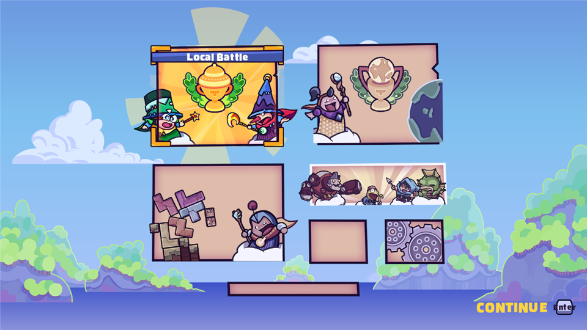
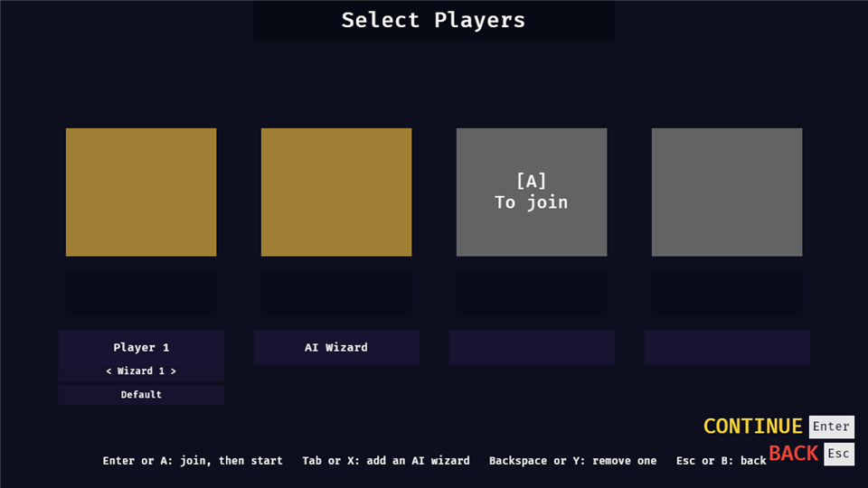
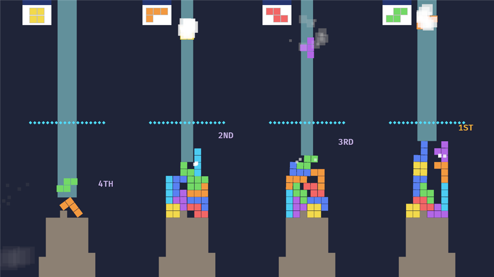
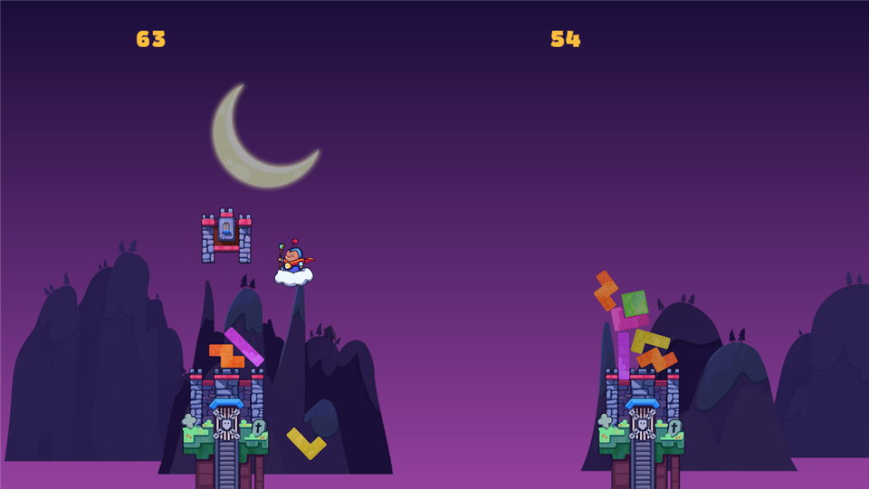
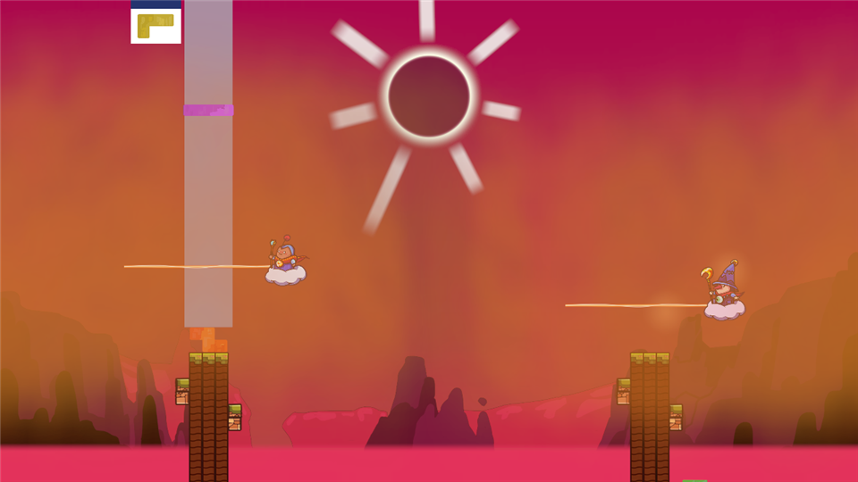

# Tricky Towers, rebuilt in Rust + Bevy

[](https://github.com/Yaekai/tricky-towers-rs/actions/workflows/test.yml)

An unofficial, from-scratch rebuild of WeirdBeard Games' physics brick-stacking game
*Tricky Towers*, aiming to match the original 1:1 (rules, values, menus, look and sound) and to
be easy to mod.

> **This repository contains no game content.** No code, art, sound, fonts or level data from
> the original are in it. The game's art and sound are read at runtime from **your own copy**
> of Tricky Towers, which you must own; without it, everything is drawn as plain shapes (as in
> the pictures below). Don't share or commit anything you extract from the game.
>
> This is a fan project, not affiliated with or endorsed by WeirdBeard Games. *Tricky Towers*
> and its content belong to their owners; to play the real game, buy it. The licence below
> covers only the code in this repository. If you hold rights to the game and want something
> changed or removed, please open an issue.

| | |
|---|---|
|  |  |
|  |  |



*All pictures use the built-in placeholder shapes, not the original's art.*

## What you need
| | |
|---|---|
| Rust | stable toolchain (`rustup`) |
| Linux only | `libasound2-dev libudev-dev libxkbcommon-dev libwayland-dev` |
| Optional: the original's look and sound | a PC install of *Tricky Towers* you own, [AssetRipper](https://github.com/AssetRipper/AssetRipper) and Windows PowerShell |

The first build compiles Bevy and takes several minutes.

## 1. Build and run
```
cargo run                                        # play, with placeholder shapes
cargo run -- --play survival --difficulty pro    # skip the menus
cargo run -- path/to/mod.ron                     # load another config
cargo test                                       # config and headless gameplay tests
```

**Keys** (the original's defaults): arrows move, Up / Space turn, Down drops faster, U / I
nudge, J light spell, K dark spell, Esc pause. Players 2 to 4 use gamepads. Keys can be
rebound in Settings → Keybinding.

## 2. Optional: use the art and sound from your own install
The scripts in [`tools/extract/`](tools/extract/README.md) read your install (exported with
AssetRipper) and fill the `extracted/` folder, which the game loads at startup. They only read
from the game. `extracted/` and `research/` are ignored by git, and the `.gitignore` is a
whitelist, so extracted files can't be committed by accident. How the folder is laid out:
[`docs/art-layout.md`](docs/art-layout.md).

## Layout
```
src/gameplay.rs, spells.rs, ai.rs   core rules, headless (no rendering or keyboard)
src/trials.rs, cups.rs, collapse.rs trials, cups, match end (headless)
src/input.rs                        writes each tower's PlayerInput (keyboard, pads, bots)
src/art.rs, letters.rs, mods.rs     loading art, sound, letters and mods at runtime
src/visuals.rs, hud.rs, packs.rs …  the in-match look, effects and shaders
src/menu.rs, select.rs, settings.rs … the menu screens
assets/config/game.ron              every tunable value (GameConfig, src/config.rs)
tools/extract/                      PowerShell scripts that stage your own install's art
docs/research/                      plain-language notes on how the original behaves
tests/                              headless gameplay and menu tests
```
Every tower, human or bot, runs through the same systems; only the writer of its `PlayerInput`
differs, which keeps bots, replays and netplay simple. More in [`PLAN.md`](PLAN.md).

## Status
✅ matches the original · 🟡 in, with gaps listed · ❌ not done

| Area | | Left to reach 1:1 |
|---|---|---|
| Controls, physics, drop speeds | ✅ | |
| Race, Survival, Puzzle at Easy / Normal / Special | ✅ | |
| Spells (17) and how they're awarded | ✅ | Auto Rotate wind-up, stone and ice transitions |
| Local multiplayer (1-4 players) and local cups | ✅ | |
| Wizards (14), animations and voices | ✅ | |
| Brick packs (8) | 🟡 | Spring's look |
| Trials (50 in 5 tiers) and tier unlock | 🟡 | checking against the original |
| Endless Race / Survival / Puzzle | 🟡 | Endless Puzzle obstacle blocks |
| Backgrounds, weather and shaders | 🟡 | some sizes and colours still estimated |
| In-match HUD and effects | 🟡 | cast beam foot decorations, explosion art |
| Match end (WINNER!, collapse, Game Completed, cup winner) | 🟡 | timings still estimated |
| Menus: start, title, players, modes, single player, endless, trials, settings, keybinding, stats, pause | 🟡 | small layout differences |
| Explanation, Help and Credits popups | 🟡 | |
| Text in the original's 19 languages | 🟡 | from the original's language files; long words can still overflow |
| Values still estimated | 🟡 | about 40 marked `(?)` in `src/` |
| Online battle menus | ❌ | planned (no online play yet) |
| Shop | ❌ | not planned |

Not in the original, kept as extras: AI wizards in local battles, the `mods/` folder and the
debug tools (F1 panel, F3 readout, scripted runs), listed in
[`docs/release-checklist.md`](docs/release-checklist.md).

What's left, in more detail: [`docs/WHATS_NEXT.md`](docs/WHATS_NEXT.md).

## More docs
- [`PLAN.md`](PLAN.md): goal, approach, architecture and milestones.
- [`docs/modding.md`](docs/modding.md): the `mods/` folder (config changes and art packs).
- [`docs/debug-tools.md`](docs/debug-tools.md): offscreen pictures and scripted runs.
- [`docs/research/`](docs/research/): what was learned about the original, in plain language.
- [`AGENTS.md`](AGENTS.md): rules for AI agents working on the repo, and the development log.

## Contributing
Pull requests for engine code are welcome. Never commit game files, extracted assets or
decompiled code; notes about how the original behaves go in `docs/research/` in your own
words. Tunable numbers go in `GameConfig`, and `cargo test` must pass.

## Credits and licence
*Tricky Towers* is by WeirdBeard Games. Built with [Bevy](https://bevyengine.org) and
[avian](https://github.com/Jondolf/avian); art is staged from your own install with
[AssetRipper](https://github.com/AssetRipper/AssetRipper). The approach follows the
[Rust rewrites and ports](https://github.com/auroraborealisno02/ai-game-modding-guides/blob/main/guides/03-rust-rewrites-and-ports.md)
guide from the AI Game Modding Guides.

The code in this repository is licensed under either of [MIT](LICENSE-MIT) or
[Apache-2.0](LICENSE-APACHE), at your option. The licence does
not cover *Tricky Towers* or anything extracted from it.
